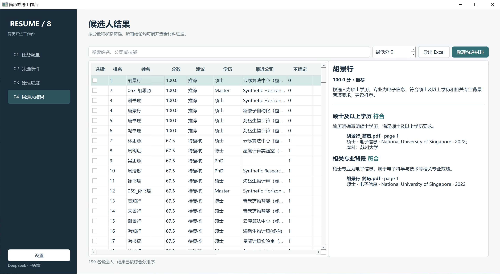

<div align="center">

# 简历筛选工作台

**把数百份散乱的 PDF / DOCX 简历，变成可核查、可筛选、可交付的候选人清单。**

本地优先 · 8 路并行 · 动态筛选条件 · Excel 证据链 · Windows 桌面应用

[](https://github.com/feizhanxia/resume-screening-agent-system/actions/workflows/ci.yml)
[](https://github.com/feizhanxia/resume-screening-agent-system/releases)
[](LICENSE)
[](https://www.python.org/)

[下载 Windows 版](https://github.com/feizhanxia/resume-screening-agent-system/releases) · [图文使用指南](docs/WINDOWS_GUIDE.md) · [参与贡献](CONTRIBUTING.md)

</div>



<div align="center"><sub>界面示例使用合成候选人数据。</sub></div>

## 它解决什么问题

选择一个简历目录，粘贴 JD 和补充要求，应用会完整登记每位候选人的材料，离线提取 PDF / DOCX / 图片内容，再用 DeepSeek 进行语义分析。最终得到带原文证据的 Excel，并可一键整理入选候选人的完整材料包。

- **不漏文件**：目录清单、提取状态、分析状态和结果行数相互核对；加密、空白、图片型和读取失败文件都会显式标记。
- **不是关键词搜索**：岗位条件在每次任务中动态拆解，支持“最接近岗位的人选”和不确定项人工复核。
- **增量且并行**：8 个 Worker 处理候选人，新文件或新条件优先复用已提取文本，不重复解析全部材料。
- **结果可追溯**：每项判断保留来源文件、页码/段落和原文摘录；模型不能凭空生成有效证据。
- **交付一步完成**：生成多工作表 Excel，并按当前筛选结果复制候选人的全部简历与补充材料。

## 4 步开始

1. 从 [Releases](https://github.com/feizhanxia/resume-screening-agent-system/releases) 下载 `Setup-x64.exe`，或解压 `portable-x64.zip` 后运行 `ResumeScreeningAgent.exe`。
2. 在设置页保存一枚你自己的 DeepSeek API Key；密钥进入 Windows 凭据管理器，不写入项目文件。
3. 选择简历根目录和输出目录，粘贴 JD 与筛选要求，确认自动拆解的条件。
4. 开始处理，在结果页核查证据、导出 Excel，并整理入选候选人的材料。

推荐目录结构：

```text
简历根目录/
├── 张三/
│   ├── 简历.pdf
│   └── 作品集.docx
└── 李四/
    ├── 中文简历.docx
    └── 论文.pdf
```

每个一级子目录代表一位候选人；其中的 PDF、DOCX、图片及其他补充材料都会进入清单，原目录不会被修改。

> 当前公开版是未签名 Beta。Windows 可能显示 SmartScreen 提示；请只从本仓库 Release 下载并核对 `windows-SHA256.txt`。项目尚未提供官方商业支持，不建议直接用于无人复核的招聘决策。

## 隐私边界

原始文件、提取缓存、SQLite、Excel 和整理后的材料始终保存在本机。配置 DeepSeek 后，应用会在每次任务前请求确认，仅发送完成基础脱敏的提取文本、JD 和筛选条件；绝对路径和原文件名不会发送。自动脱敏无法保证识别所有个人信息，使用者仍需取得合法授权。

不配置 API Key 时可以完成扫描和离线提取，但语义判断会标为待复核。详见 [隐私说明](PRIVACY.md) 与 [安全策略](SECURITY.md)。

## 输出与核查

- 候选人总表、条件判断、证据、文件清单、异常与覆盖审计等 Excel 工作表
- 推荐 / 不推荐 / 待复核状态以及接近度评分
- 文件级提取终态和条件级判断终态
- 可恢复的 SQLite 状态与内容缓存
- 经哈希校验的候选人材料副本

外部事实，例如高校排名、院校类别和论文层级，不会仅凭模型记忆强判；当前会标为需要外部核查。这是有意保留的人审边界。

## 源码运行

需要 Python 3.12：

```bash
python -m venv .venv
.venv\Scripts\activate
python -m pip install -e ".[dev]"
python -m resume_agent.app
```

质量检查：

```bash
ruff check src tests
pytest
```

Windows 本地打包：

```powershell
powershell -ExecutionPolicy Bypass -File deploy/build_windows.ps1 -RequireInstaller
```

版本 tag 会通过 GitHub Actions 生成安装器、便携版、依赖清单、SHA-256 和 Release。架构说明见 [总体架构](docs/ARCHITECTURE.md) 与 [标准 Agent Loop](docs/AGENT_LOOP.md)。

## 项目状态

这是 `0.1.x` Beta，欢迎提交使用反馈、合成测试样本和改进 PR。近期重点是更强的复杂版式覆盖、可选的本地模型后端、外部事实核查适配器，以及可复现的批量性能基准。完整变化见 [CHANGELOG](CHANGELOG.md)。

如果它解决了你的批量简历整理问题，欢迎点一个 Star，让更多需要本地优先招聘工具的人看到它。

---

<sub>English: A local-first Windows desktop app that turns folders of PDF/DOCX resumes into evidence-backed, reviewable screening results. The UI is currently Chinese; English localization is planned.</sub>

MIT © 2026 [feizhanxia](https://github.com/feizhanxia)
