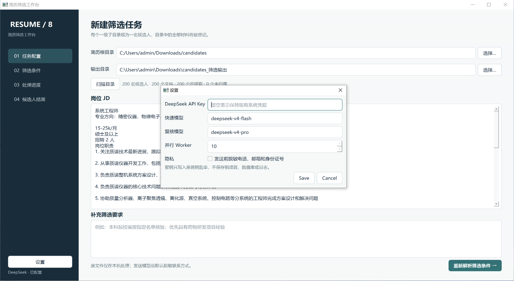
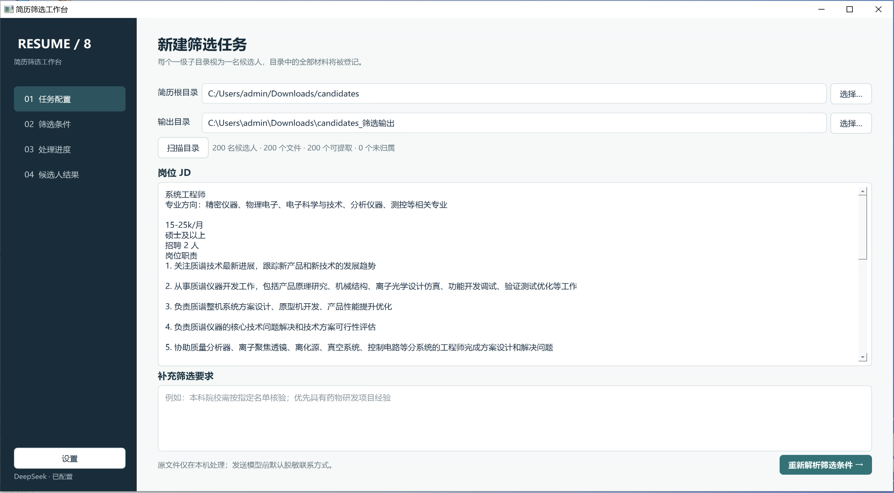
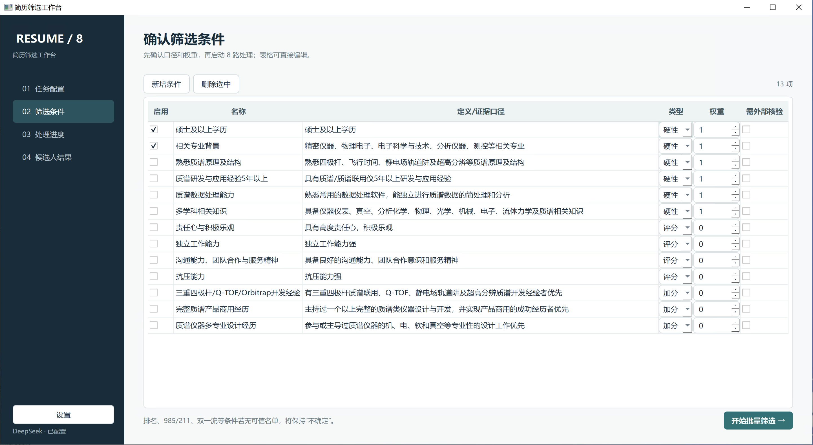
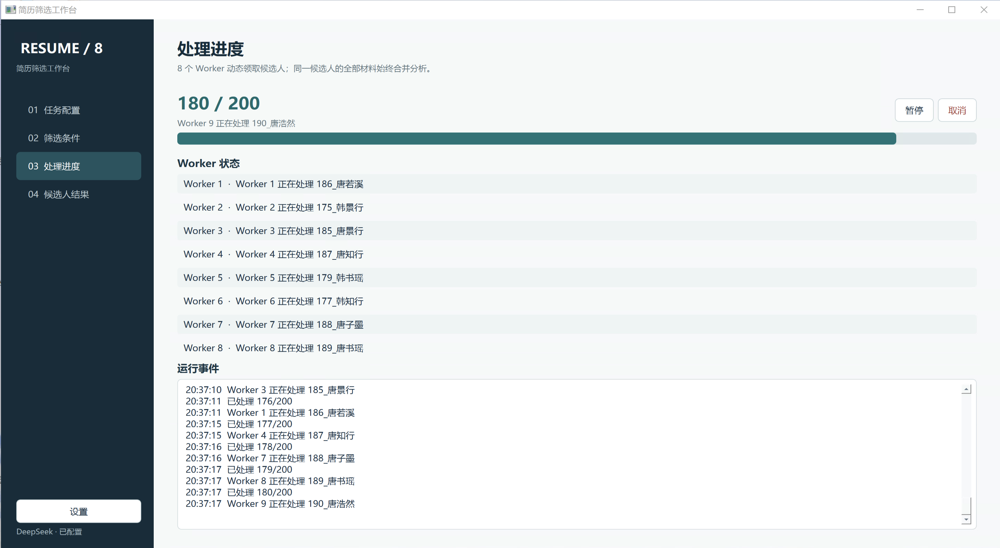
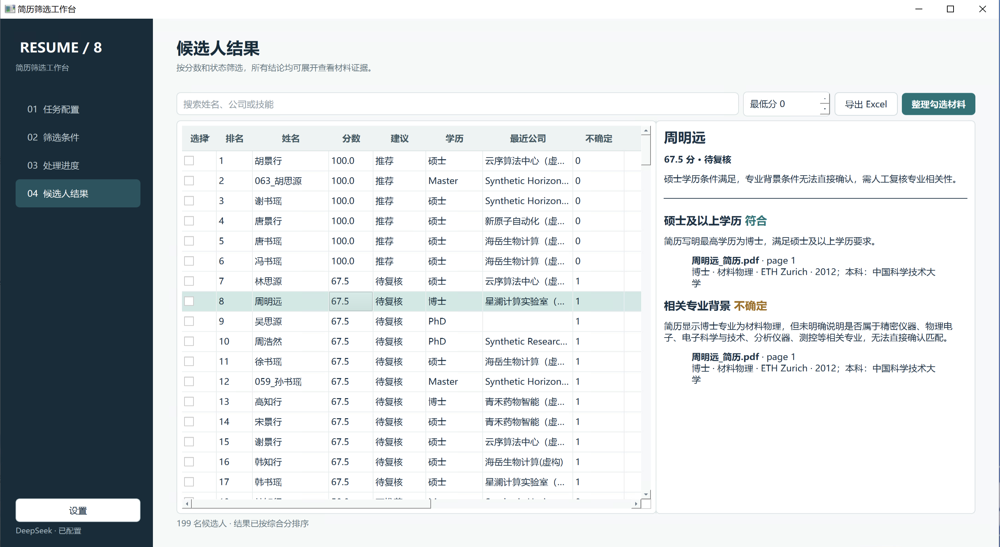

# Windows 使用指南

## 1. 下载与启动

在仓库的 [Releases 页面](https://github.com/feizhanxia/resume-screening-agent-system/releases) 下载：

- `ResumeScreeningAgent-Setup-x64.exe`：推荐，安装后可从开始菜单启动。
- `ResumeScreeningAgent-portable-x64.zip`：免安装，完整解压后双击 `ResumeScreeningAgent.exe`。不要只把 EXE 单独移出目录。

当前 Beta 尚未购买代码签名证书，Windows 可能显示 SmartScreen 提示。请确认发布者页面是本仓库，并使用同一 Release 中的 `windows-SHA256.txt` 核对文件。

## 2. 配置 DeepSeek

打开“设置”，填写自己的 API Key。应用只把密钥保存在 Windows 凭据管理器；请勿把密钥贴到 Issue、截图或日志中。

## 3. 创建任务

选择简历根目录、输出目录，粘贴岗位 JD 和额外筛选要求。简历根目录下每个一级子目录代表一位候选人，子目录中的所有材料会作为一个整体处理。

## 4. 确认筛选条件

应用会把自然语言要求拆成可逐项核查的条件。开始前检查必须项、加分项、权重和外部事实标记；条件不合适时返回修改原始要求。

## 5. 执行与覆盖核查

八个 Worker 并行处理候选人。进度页会显示扫描、提取、分析和异常数量；暂停或意外退出后可以复用已完成结果。

加密、空白、损坏或无法提取的文件不会消失，而会进入异常或待复核列表。

## 6. 查看结果与整理材料

结果页可以查看推荐候选人、得分、逐项判断和原文证据。确认筛选范围后可导出 Excel，并把对应候选人的完整目录复制到输出位置。

“待复核”不是失败：它表示材料不足、证据冲突、外部事实待查或文件需要人工查看。不要把模型分数直接当作最终录用结论。

## 常见问题

### 不填 API Key 能否使用？

可以完成扫描、离线提取、文件清单和覆盖检查；需要语义理解的条件会标为待复核。

### 新增简历后需要全部重跑吗？

不需要。再次选择同一目录时，应用通过文件指纹复用未变化的提取结果，只处理新增或变化材料，并按当前条件更新分析结果。

### 原始简历会上传吗？

不会。原文件始终留在本机。启用 DeepSeek 时，在你每次确认后会发送完成基础脱敏的提取文本、JD 和条件，详见 [隐私说明](../PRIVACY.md)。

### 为什么学校排名等条件显示待核查？

应用内置带来源和版本的教育部985、211及第二轮双一流高校与学科名单。对于本科院校类别，只有校名和简历原文能够精确对应时才自动判断；排名前20、综合性大学、双一流学科但缺少专业信息等条件仍保留为待核查，以降低误筛风险。

更完整的排障方法见 Word 版手册：[简历筛选工作台-Windows版使用手册.docx](简历筛选工作台-Windows版使用手册.docx)。
